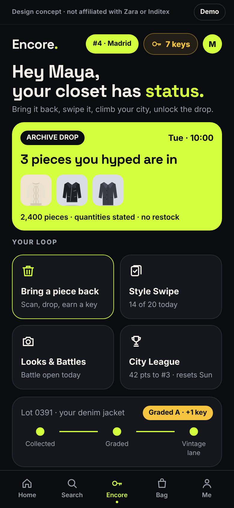
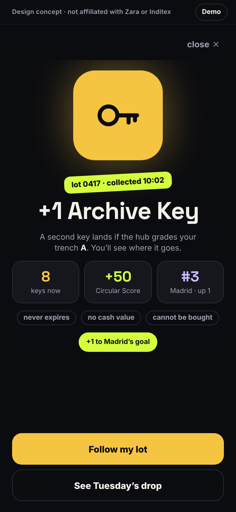
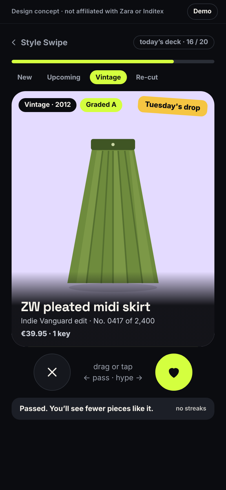
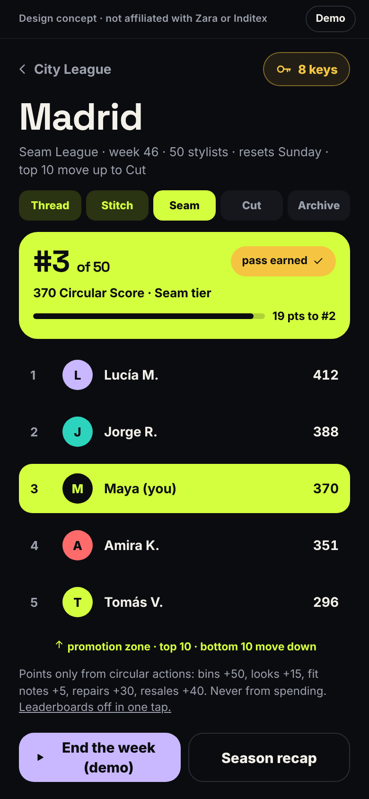
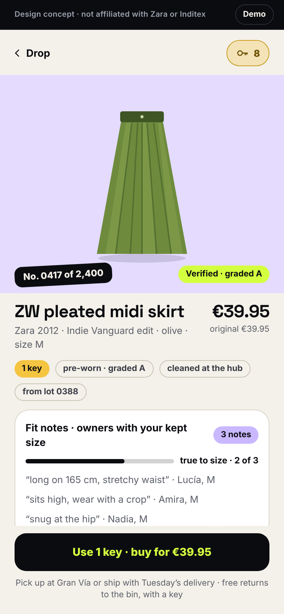

# Encore

**Your old Zara gets you into the new drop.** Encore is a circular-fashion concept designed to live as its own tab inside the Zara app. This repository is a working, clickable, mobile-first build of all 25 screens.

> **Design concept.** A student project for the BIC × Zara case competition (Round 1, Fall 2026) by Victor Hsu (captain), Juliet Dong, Sophie Hsu and Kaitlyn Lavichant. Not affiliated with or endorsed by Zara or Inditex. All people, numbers and lots are illustrative.

<p>
  
  
  
  
  
</p>

## The idea

Secondhand Zara has no status, no date and no drop, so buying new always wins. Encore fixes that with one currency, the **Archive Key**, which you can only earn by bringing a Zara garment back to an **Encore Bin** in store. Keys open **Archive Drops** every Tuesday at 10:00. Between drops, a community layer (daily Style Swipe deck, Looks feed, closets, Style Battles, weekly City Leagues and a shared city goal) keeps people coming back.

The loop: **bring it back → swipe → climb → unlock.** Keys open the door; money buys the piece. Nothing is earned by spending.

## Run it

Needs Node 20 or newer.

```bash
npm install
```

```bash
npm run dev
```

Other scripts:

| Command | What it does |
|---|---|
| `npm test` | Runs the unit tests for the business rules |
| `npm run build` | Type-checks and builds the static site into `dist/` |
| `npm run preview` | Serves the built site locally |

The build is a plain static site with relative paths and hash routing, so `dist/` works on any host or sub-path (Vercel, Netlify, GitHub Pages) with no server configuration. To publish on GitHub Pages: in the repository settings set **Pages → Source** to **GitHub Actions**, then run the **Deploy to GitHub Pages** workflow from the Actions tab.

## Demo it

- **On a phone** the app fills the screen. The **Demo** button in the top strip opens Judge mode, Reset demo and the list of all screens.
- **On a laptop** the phone sits in a frame with every screen listed on the left and the guide for the current screen on the right.
- **Judge mode** walks the story in seven moves, each ticked from real state: set up → return a trench → swipe the deck → follow Lucía → vote in the battle → end the week → buy the skirt. Maya goes from 7 keys to 8, then back to 7, and buying earns 0 points.
- **Reset demo** restores the starting state. State is saved in the browser, so a refresh keeps your place.

What is simulated: the camera and label scan, the bin's scale and RFID reader, payment, notifications, moderation and the product catalogue. Garment art is placeholder SVG.

## The rules the app enforces

- **Keys are earned only by bringing Zara garments back.** 1 key per garment, +1 if the hub grades it A, capped at 10 a month. Keys never expire, have no cash value, and cannot be bought, sold or transferred.
- **Points (Circular Score) come only from circular actions.** Buying anything earns 0.
- **No dark patterns.** No countdown timers, no "only 3 left", no streaks; one reminder per drop. Quantities are stated plainly.
- **Prices:** vintage grade A at the original price, grade B at 70%; re-cut editions at atelier prices; first access at the store price. Nothing is marked down.
- **Honest claims:** facts only ("pre-worn, graded A, lot 0417"). No sustainability or offset language.
- **Consent first:** the city is declared, photos are opt-in, leagues and battles are 16+, and leaderboards, photos and notifications each turn off in one tap without losing keys.

These live as pure functions in [`src/rules.ts`](src/rules.ts) (`keysForReturn`, `pointsFor`, `tierFor`, `canEnterDrop`, `priceFor`, `buy`, `weeklyLeagueResult`, `cityGoalProgress`, `vote`) with tests in [`src/rules.test.ts`](src/rules.test.ts). The tests also check that the demo data is consistent with itself.

## How it is built

Vite, React and TypeScript, with React Router, a Zustand store saved to `localStorage`, Vitest, and plain CSS built on the design tokens. Fonts (Space Grotesk, Inter) are bundled, so the app has no runtime network dependencies.

| Path | What it is |
|---|---|
| `data/seed.json` | All demo data. Every screen reads from it through the store. |
| `src/rules.ts` | The business rules as pure functions |
| `src/store.ts` | State, actions and the selectors every number on screen comes from |
| `src/screens/` | The 25 screens, grouped by chapter |
| `src/components/ui.tsx` | Shared components: top bar, key counter, chips, cards, buttons, tier track, lot timeline, sheets, ticket, tab bar |
| `src/guide.ts` | Screen list, guide text and the Judge mode steps |
| `src/styles.css`, `design/tokens.json` | The design system |
| `public/garments/` | Placeholder garment illustrations |
| `design/screenshots/` | A screenshot of every screen |
| `docs/` | Product spec, screens, design system, data model, build plan, business case, sources |
| `video/` | Narration script and captions for the walkthrough video |

**Swapping in real product photos:** change a garment's `image` in `data/seed.json` to a photo URL (or a file under `public/`). Tiles use `object-fit: contain`, so the layout does not change.

## Docs

1. [`docs/PRODUCT_SPEC.md`](docs/PRODUCT_SPEC.md): every rule. The source of truth for logic.
2. [`docs/SCREENS.md`](docs/SCREENS.md): all 25 screens with screenshots.
3. [`docs/DESIGN_SYSTEM.md`](docs/DESIGN_SYSTEM.md): colors, type, components.
4. [`docs/DATA_MODEL.md`](docs/DATA_MODEL.md): entities and rule functions.
5. [`docs/OPEN_QUESTIONS.md`](docs/OPEN_QUESTIONS.md): every decision made during the build, and what is still open.
6. [`docs/BUSINESS_CASE.md`](docs/BUSINESS_CASE.md) and [`docs/SOURCES.md`](docs/SOURCES.md): why it exists, the pilot and the works cited.
