# Screens

All 25 screens of the Encore tab, in the order a new user meets them. Each has: source (`design/screens-source/<File>.dc.html`), a runnable static copy (`design/screens-standalone/<File>.html`), a 2x screenshot (`design/screenshots/<File>.png`), the designer's step guide, where its buttons go, and its interactive state.

Every screen is a 390×844 phone frame. Navigation is by tapping links; `links_to` lists the targets.

## 0 · Start here: the Encore hub inside the Zara app

### 0.1 · Encore Home  
`Main.dc.html` → suggested route `/main`

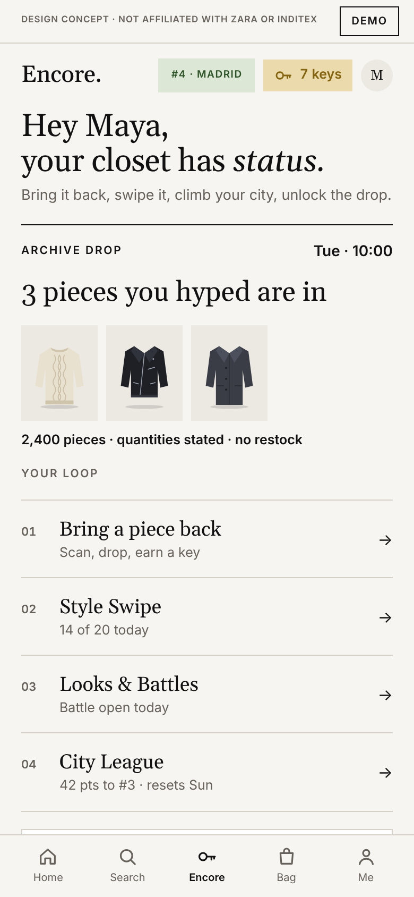

**What happens.** Open the Encore tab. Top of the screen: your Archive Keys (gold) and your league rank (lime). Below: next Tuesday's drop, the pieces you have hyped, and four big actions. Tap 'Bring a piece back' to start earning. The loop is visible at a glance: bring back, swipe, climb, unlock.

**Links to:** `DropHome.dc.html`, `Keys.dc.html`, `League.dc.html`, `Looks.dc.html`, `LotTracker.dc.html`, `Profile.dc.html`, `Scan.dc.html`, `Swipe.dc.html`

### 0.2 · First open: consent and city  
`Onboarding.dc.html` → suggested route `/onboarding`

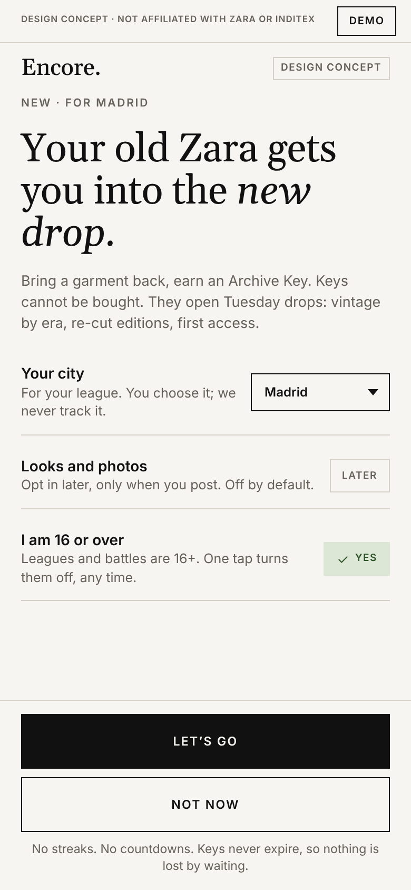

**What happens.** One screen, three choices, no dark patterns: declare your city (never tracked), opt in to photos later, and confirm you are 16 or over. Keys never expire and are never sold, so there is nothing to lose by waiting. 'Not now' is as big as 'Let's go'.

**Links to:** `Main.dc.html`

## 1 · Bring it back: earn an Archive Key in about a minute

### 1.1 · Scan the care label  
`Scan.dc.html` → suggested route `/scan`

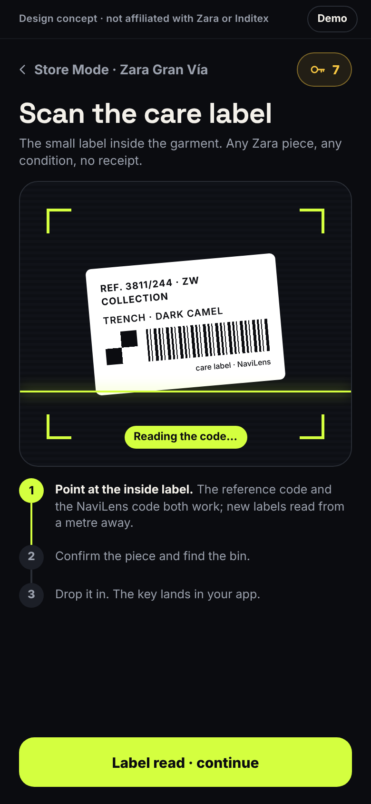

**What happens.** In store, open Store Mode and point the camera at the inside care label. The app reads the reference code (and the NaviLens code on new labels). Any Zara garment, any condition, no receipt. Lime scan line and a haptic tick when it reads.

**Links to:** `Confirm.dc.html`, `Main.dc.html`

### 1.2 · Garment confirmed  
`Confirm.dc.html` → suggested route `/confirm`

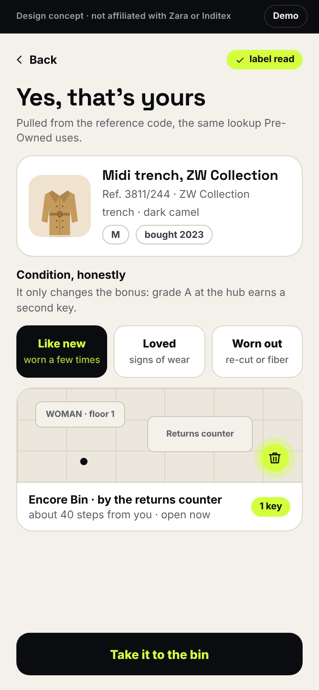

**What happens.** The catalogue photo, name, season and composition appear from the reference code, the same lookup Pre-Owned uses. You confirm condition honestly (it only affects the grade-A bonus) and the map shows the Encore Bin by the returns counter.

**Links to:** `Drop.dc.html`, `Scan.dc.html`

### 1.3 · Drop it in the Encore Bin  
`Drop.dc.html` → suggested route `/drop`

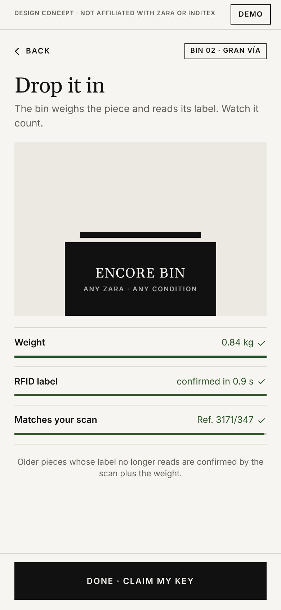

**What happens.** Put the garment in the Encore Bin. The bin weighs it and its reader confirms the RFID label on recent pieces; older pieces are confirmed by scan plus weight. The screen shows the live read so the user sees it count.

**Links to:** `Confirm.dc.html`, `KeyLanding.dc.html`

### 1.4 · Key landing  
`KeyLanding.dc.html` → suggested route `/key-landing`

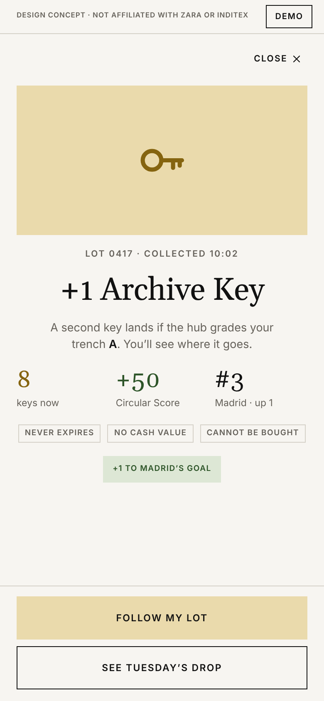

**What happens.** The moment that matters: a gold key drops in with confetti, '+1 Archive Key', the lot number and a note that a second key arrives if the hub grades the piece A. Share card optional. Never a voucher, never a discount.

**Links to:** `CityGoal.dc.html`, `DropHome.dc.html`, `LotTracker.dc.html`, `Main.dc.html`

### 1.5 · Where your garment went  
`LotTracker.dc.html` → suggested route `/lot-tracker`

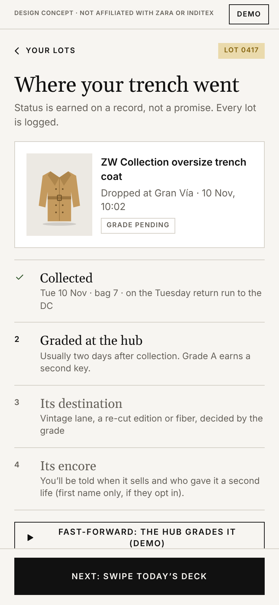

**What happens.** Every garment gets a lot number the user can follow: Collected, Graded at the hub, then Vintage lane, Re-cut edition or Fiber. When a piece sells in a drop, the original owner sees 'your 2023 blazer went to No. 0417'. Status is earned on a record, not a promise.

**Links to:** `Main.dc.html`, `Swipe.dc.html`

## 2 · Style Swipe: 20 cards a day that teach the drop your taste

### 2.1 · Style Swipe deck  
`Swipe.dc.html` → suggested route `/swipe`

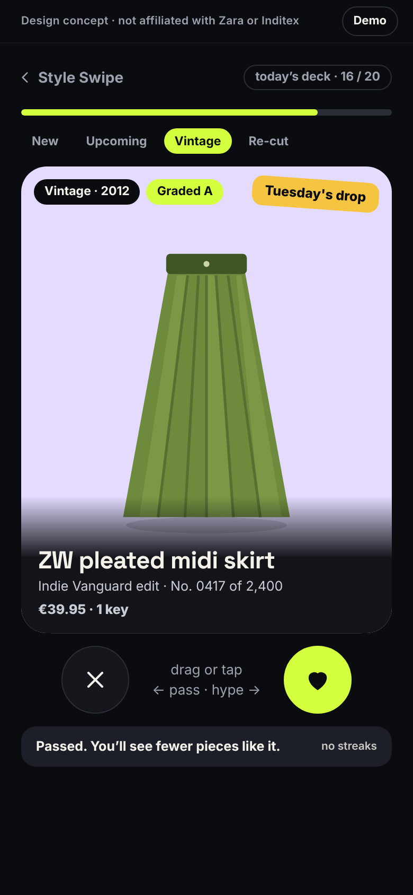

**What happens.** 20 cards a day: this week's drop, next month's limited pieces, graded vintage. Swipe right to hype, left to pass (tap the buttons here). A hyped piece gets you first word on Tuesday; your swipes also tell Arteixo what to make. No streaks: skip a day and nothing is lost.

**Links to:** `DeckDone.dc.html`, `FitNote.dc.html`, `Main.dc.html`

**Interactive:** handlers `hype, pass`; initial state `{ i: 11, hyped: 3, last: null }`

### 2.2 · Fit note  
`FitNote.dc.html` → suggested route `/fit-note`

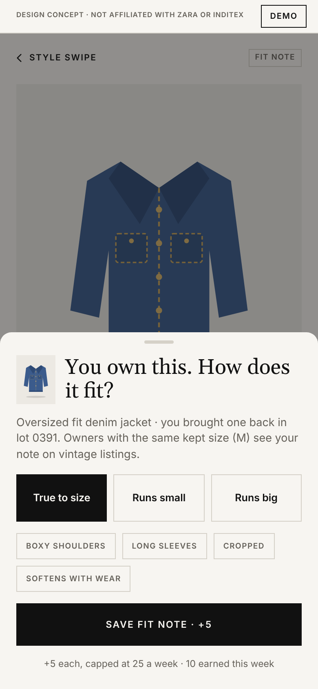

**What happens.** If you own a piece in the deck, add a fit note in one tap: true to size, runs small, runs big. +5 points, capped at 25 a week. Fit notes from owners with your kept size then appear on vintage listings, which answers the third secondhand barrier.

**Links to:** `DeckDone.dc.html`, `Swipe.dc.html`

### 2.3 · Deck complete  
`DeckDone.dc.html` → suggested route `/deck-done`

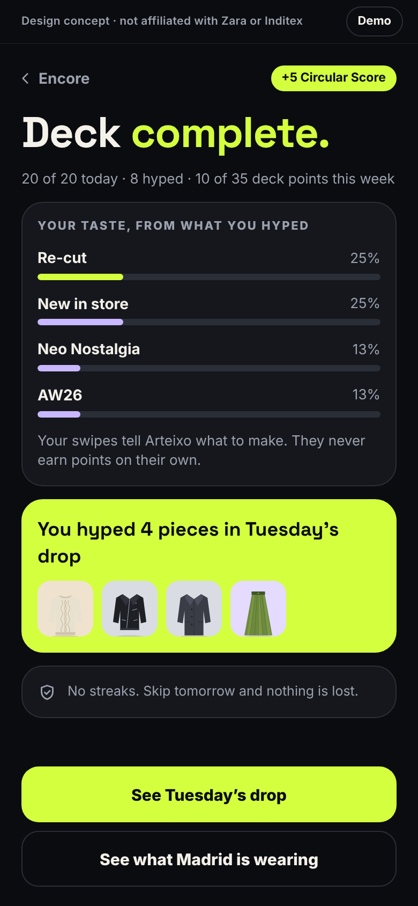

**What happens.** +5 points and your taste profile: which edits you hype most, which eras, which fits. 'You hyped 3 pieces in Tuesday's drop' links straight to the drop teaser. Points are visible, small, and only for actions.

**Links to:** `DropHome.dc.html`, `Looks.dc.html`, `Swipe.dc.html`

## 3 · Looks, closets and the city: the Circular Style Network

### 3.1 · Looks feed  
`Looks.dc.html` → suggested route `/looks`

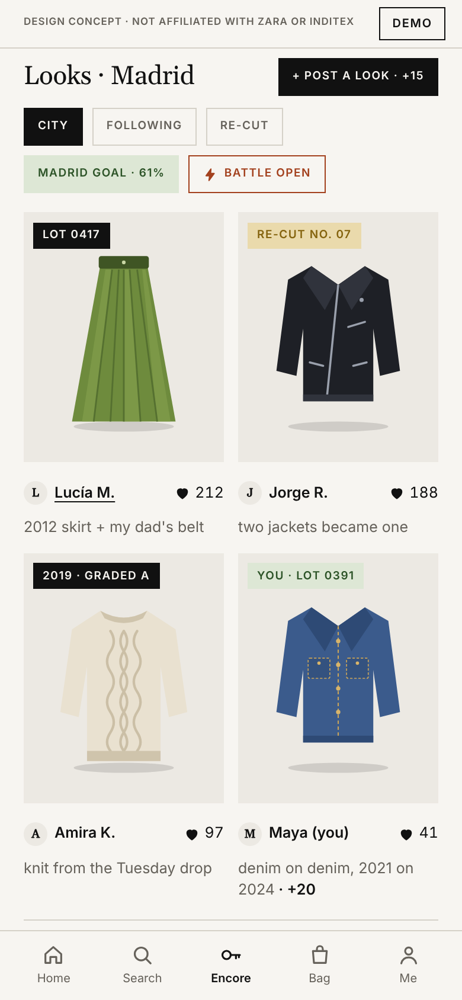

**What happens.** A city feed of real customers wearing secondhand and re-cut Zara, tagged with the lot and the pieces. Hearts are swipes: 10 hearts give the poster +5. Lilac is the community color. Photos are opt-in and moderated; the city is the one you declared.

**Links to:** `Battle.dc.html`, `CityGoal.dc.html`, `Closet.dc.html`, `Main.dc.html`, `PostLook.dc.html`, `Profile.dc.html`

### 3.2 · Post a look  
`PostLook.dc.html` → suggested route `/post-look`

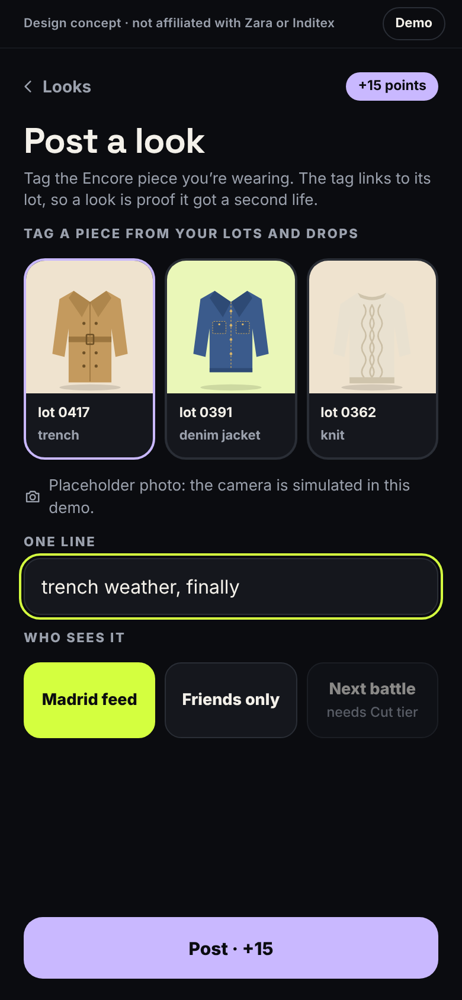

**What happens.** Take or pick a photo, tag the Encore pieces in it from your lots and drops, add one line, post. +15 points. The tagged piece links to its lot, so a look is also proof the garment got a second life.

**Links to:** `Battle.dc.html`, `Looks.dc.html`

### 3.3 · Style Battle  
`Battle.dc.html` → suggested route `/battle`

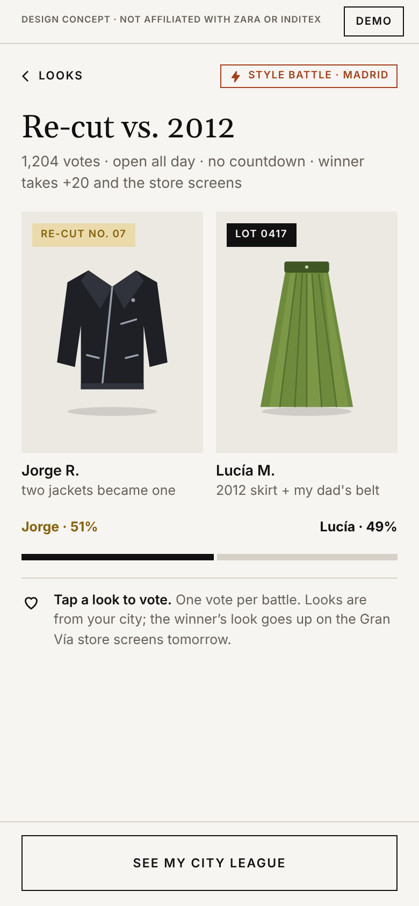

**What happens.** Two looks go head to head for a city vote; tap a side to vote and watch the bar move. The winner takes +20 and a spot on the store screens. Open all day, no countdown. Entry needs the Cut tier, so it is something to climb for.

**Links to:** `League.dc.html`, `Looks.dc.html`

**Interactive:** handlers `voteA, voteB`; initial state `{ a: 611, b: 593, choice: null }`

### 3.4 · A stylist's closet  
`Closet.dc.html` → suggested route `/closet`

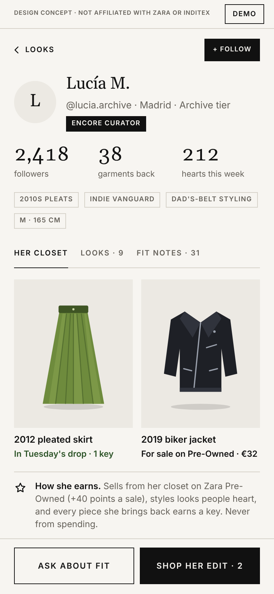

**What happens.** Tap 'Following' or a name in Looks. Every user has a closet page: followers, aesthetic tags, the pieces they brought back (and where those are now), pieces for sale on Zara Pre-Owned, looks and fit notes. Follow, ask about fit, shop their edit. Curators are the 'Depop famous' of Encore: status comes from taste and returns, never from spending.

**Links to:** `DropLive.dc.html`, `FitNote.dc.html`, `Looks.dc.html`, `Piece.dc.html`

**Interactive:** handlers `follow`; initial state `{ following: false }`

### 3.5 · City goal  
`CityGoal.dc.html` → suggested route `/city-goal`

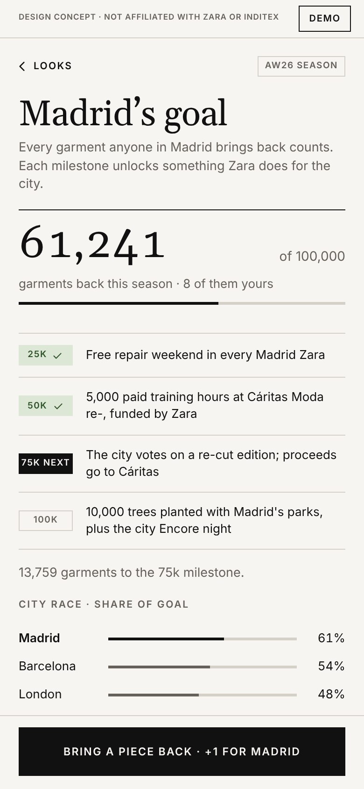

**What happens.** Every garment anyone in the city brings back counts toward one shared season goal. Milestones unlock things Zara does for the city: a free repair weekend, paid training hours at Cáritas Moda re-, a city-voted re-cut edition, 10,000 trees with the parks department and the Encore night. Cities race each other. Rewards are stated as actions with numbers, never as offsets.

**Links to:** `Looks.dc.html`, `Scan.dc.html`

## 4 · City League: rank, passes and Encore Wrapped

### 4.1 · City League  
`League.dc.html` → suggested route `/league`

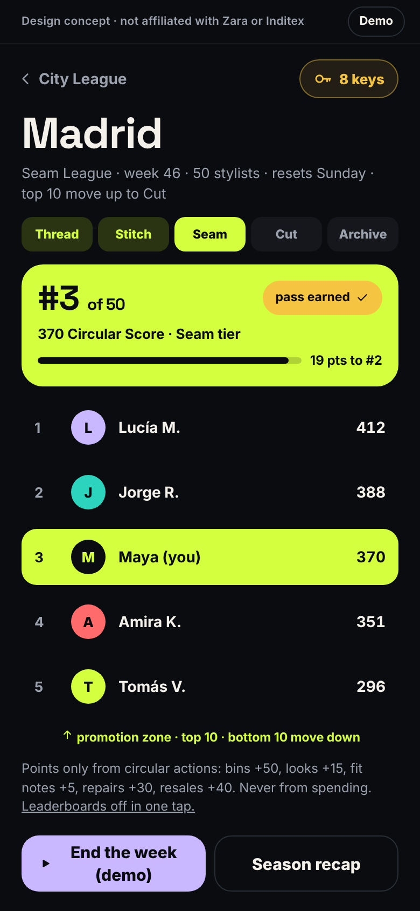

**What happens.** Leagues of 50 in your city, reset every Sunday. Top 10 move up, bottom 10 move down. The tier track shows Thread, Stitch, Seam, Cut, Archive. Tap 'End the week' to see the promotion moment. Points come only from circular actions, never from spending; one tap turns it all off.

**Links to:** `Keys.dc.html`, `Main.dc.html`, `Pass.dc.html`, `Tiers.dc.html`, `Wrapped.dc.html`

**Interactive:** handlers `endWeek, reset`; initial state `{ promoted: false }`

### 4.2 · Skip-the-line pass  
`Pass.dc.html` → suggested route `/pass`

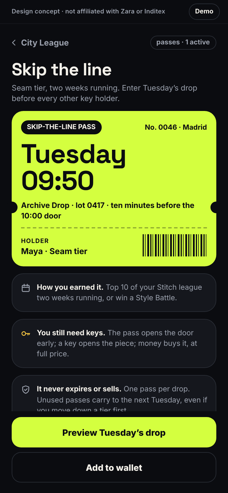

**What happens.** Reach Seam (or win a battle) and a ticket appears: enter next Tuesday's drop ten minutes before other key holders. It costs Zara nothing, because the piece sells out anyway, and it is the reward Gen Z names first.

**Links to:** `DropHome.dc.html`, `League.dc.html`, `Main.dc.html`

### 4.3 · Encore Wrapped  
`Wrapped.dc.html` → suggested route `/wrapped`

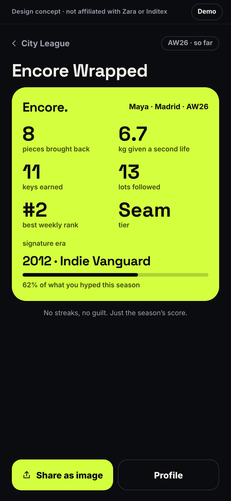

**What happens.** At the end of each season (SS, AW) a recap card: garments returned, lots followed, keys earned, kilograms displaced, your city rank and your signature era. One tap shares it as an image. No streaks, no guilt, just the season's score.

**Links to:** `League.dc.html`, `Main.dc.html`, `Profile.dc.html`

### 4.4 · Tiers and what they unlock  
`Tiers.dc.html` → suggested route `/tiers`

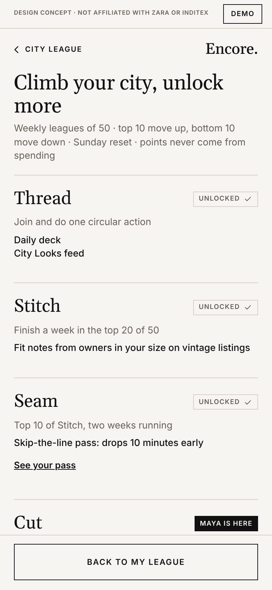

**What happens.** Tap any tier on the league screen. Thread: join and do one circular action (daily deck, city feed). Stitch: a week in the top 20 of 50 (fit notes from owners in your size). Seam: top 10 of Stitch two weeks running (skip-the-line pass, 10 minutes early). Cut: top 10 of Seam plus two garments back this season (+1 key a month, Style Battle entry). Archive: top 5% of the city at season end (+2 keys a season, Insider badge, Encore night, first look at re-cut editions).

**Links to:** `League.dc.html`, `Pass.dc.html`

## 5 · Archive Drops: keys open the door, money buys the piece

### 5.1 · This Tuesday's drop  
`DropHome.dc.html` → suggested route `/drop-home`

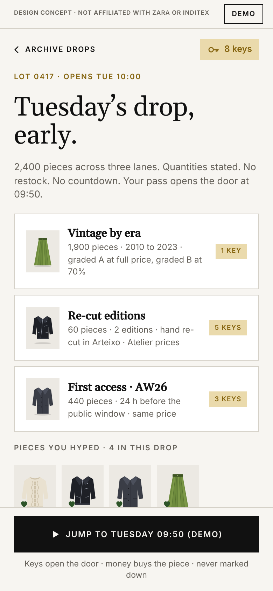

**What happens.** Monday the teaser opens: the three lanes, how many pieces in each, which keys they take, and the pieces you hyped in the deck. Quantities are stated; there is no countdown and no restock. A pass holder sees their early entry time.

**Links to:** `DropLive.dc.html`, `Keys.dc.html`, `Main.dc.html`

### 5.2 · Drop live: three lanes  
`DropLive.dc.html` → suggested route `/drop-live`

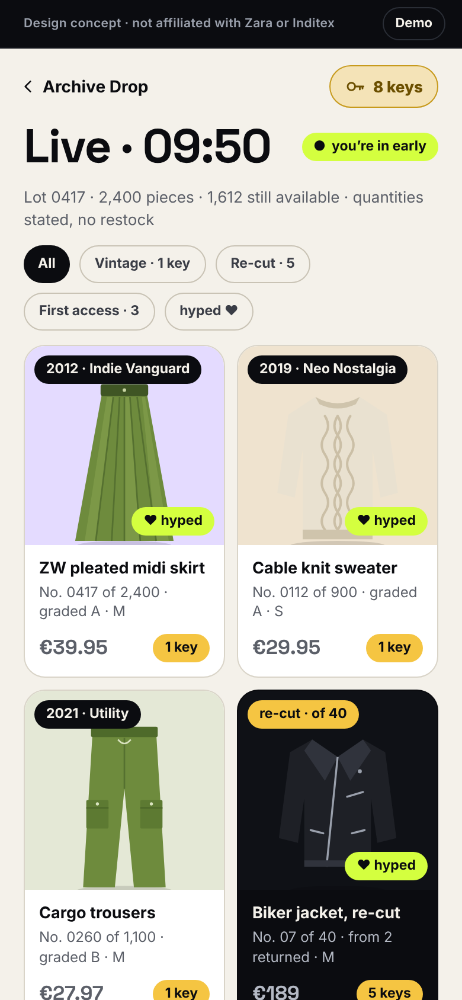

**What happens.** Tuesday 10:00. Vintage by era takes 1 key, re-cut editions 5, first access 3. Vintage grade A sells at the original price and grade B at 70%; nothing is ever marked down. The key opens the door, money buys the piece. Tap a piece to see its story.

**Links to:** `DropHome.dc.html`, `Piece.dc.html`

### 5.3 · Piece detail  
`Piece.dc.html` → suggested route `/piece`

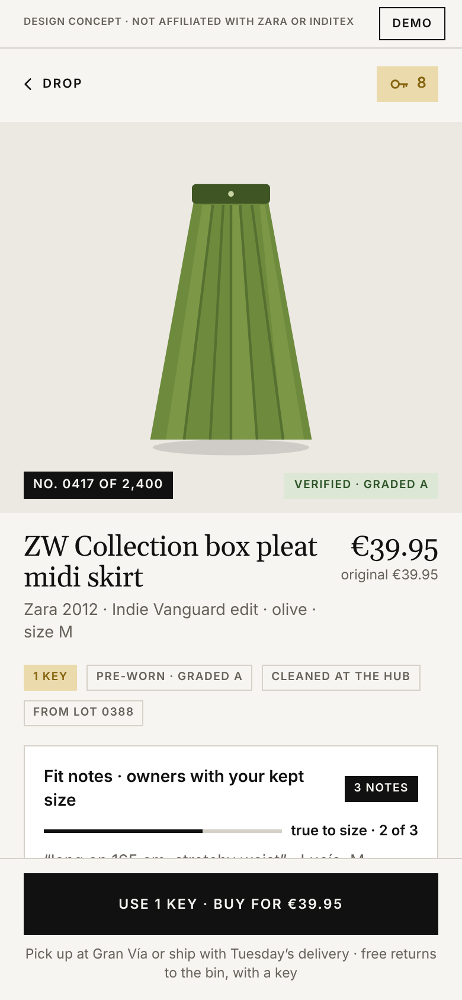

**What happens.** Every vintage piece carries its number ('No. 0417 of 2,400'), its grade, its era edit, fit notes from owners with your size, and the lot it came from. Facts only: 'pre-worn, graded A', never 'sustainable'. Use a key to buy.

**Links to:** `DropLive.dc.html`, `YoureIn.dc.html`

### 5.4 · You're in  
`YoureIn.dc.html` → suggested route `/youre-in`

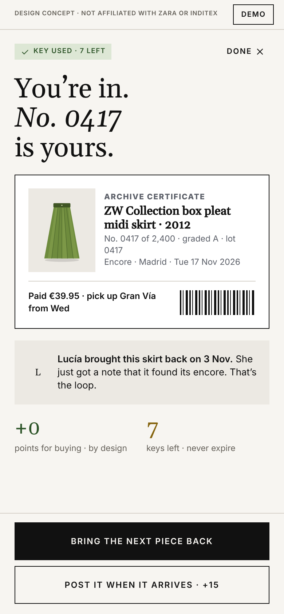

**What happens.** The key is spent, the piece is yours, and a certificate card is added to your profile. Pick up in store or ship with the Tuesday delivery. The original owner of the garment is told their lot found its encore. Next prompt: bring the next piece back.

**Links to:** `Main.dc.html`, `PostLook.dc.html`, `Scan.dc.html`

## 6 · Keys and profile

### 6.1 · Keys wallet  
`Keys.dc.html` → suggested route `/keys`

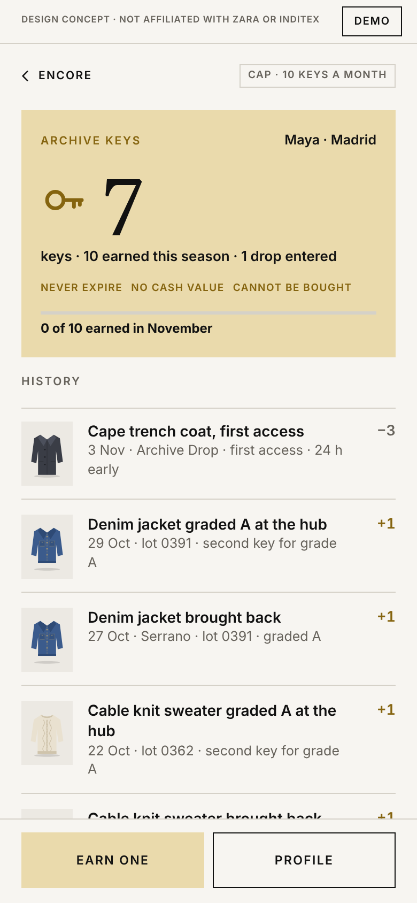

**What happens.** Every key earned and spent, with the garment and the drop behind it. Keys never expire, carry no cash value and cannot be bought or transferred. The cap (10 a month) is shown plainly so nobody is surprised.

**Links to:** `Main.dc.html`, `Profile.dc.html`, `Scan.dc.html`

### 6.2 · Profile and badges  
`Profile.dc.html` → suggested route `/profile`

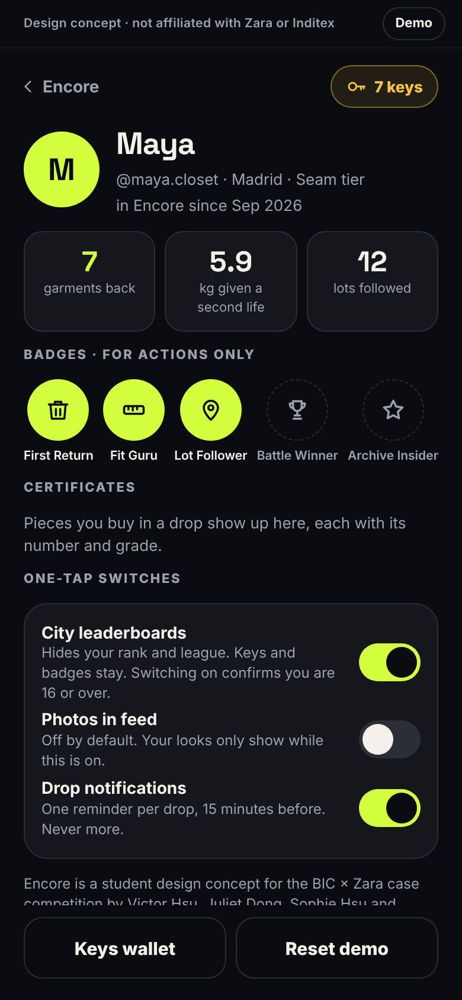

**What happens.** Badges are for actions: First Return, Fit Guru, Lot Follower, Battle Winner, Archive Insider. Stats: garments returned, kilograms displaced, lots followed. Leaderboards, photos and notifications each have a one-tap switch here.

**Links to:** `Keys.dc.html`, `Main.dc.html`
